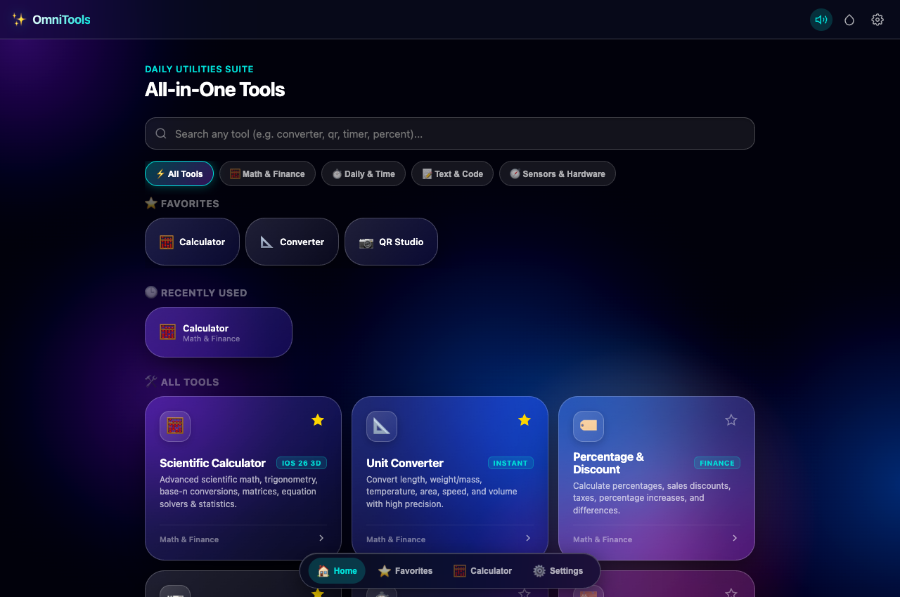
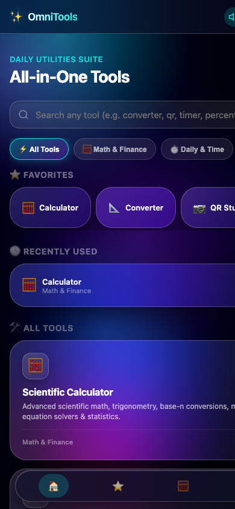
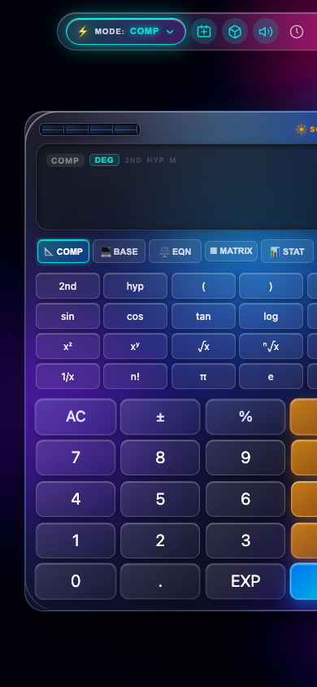

# OmniTools — Modern All-in-One Professional Tools & Utilities App 🛠️⚡📱

An ultra-refined, futuristic, and responsive **All-in-One Tools App** engineered with **modern Liquid Glass aesthetics**, interactive **GSAP physics**, tactile acoustic feedback, and dynamic 3D spatial perspective. 

OmniTools consolidates essential daily calculation, conversion, text analysis, media, and hardware sensor tools into a single lightning-fast, 100% on-device, offline-capable web application.

[](https://calculator-teal-xi-43.vercel.app)
[](https://github.com/Menelik288/tools-app)
[](LICENSE)
[](#-privacy--offline-architecture)

---

## 📸 Screenshots & Previews

<div align="center">
  <h3>OmniTools Home Screen — Dashboard & Tools Grid</h3>
  
  <br><br>
  <div style="display: flex; justify-content: center; gap: 20px; flex-wrap: wrap;">
    <div>
      <h4>Mobile Responsive Dashboard</h4>
      
    </div>
    <div>
      <h4>Scientific Calculator Module</h4>
      
    </div>
  </div>
</div>

---

## 🧰 Integrated Tools & Features

### 1. 📐 Unit Converter
A high-precision bidirectional unit conversion engine across 6 major domains:
- **Length & Distance**: Meters ($m$), Kilometers ($km$), Centimeters ($cm$), Millimeters ($mm$), Micrometers ($\mu m$), Nanometers ($nm$), Miles ($mi$), Yards ($yd$), Feet ($ft$), Inches ($in$), Nautical Miles ($nmi$).
- **Weight & Mass**: Kilograms ($kg$), Grams ($g$), Milligrams ($mg$), Metric Tons ($t$), Pounds ($lb$), Ounces ($oz$), Stone ($st$), Carats ($ct$).
- **Temperature**: Celsius (°C), Fahrenheit (°F), Kelvin ($K$), Rankine (°R).
- **Area & Land**: Square Meters ($m^2$), Square Kilometers ($km^2$), Square Centimeters ($cm^2$), Square Feet ($ft^2$), Square Yards ($yd^2$), Acres ($ac$), Hectares ($ha$), Square Miles ($mi^2$).
- **Speed & Velocity**: Meters per second ($m/s$), Kilometers per hour ($km/h$), Miles per hour ($mph$), Knots ($kn$), Feet per second ($ft/s$).
- **Volume & Capacity**: Liters ($L$), Milliliters ($mL$), Cubic Meters ($m^3$), Cubic Centimeters ($cm^3$), US Gallons ($gal$), Quarts ($qt$), Pints ($pt$), Cups, Fluid Ounces ($fl\ oz$), Tablespoons ($tbsp$), Teaspoons ($tsp$).
- **Live Interactivity**: Instant bidirectional recalculation as you type in either input, unit swap button ($\rightleftharpoons$), copy result to clipboard, and quick equivalents reference card.

### 2. 📷 QR Code Studio & Scanner
A full-featured QR code management suite:
- **Live Camera Scanner**: High-speed camera scanner using WebRTC with visual target reticle, scanning laser, front/rear camera flipper, and hardware LED torch toggle.
- **QR Code Studio (Generator)**: Specialized presets for:
  - **Plain Text & Messages**
  - **Website URLs**
  - **Contact vCards** (Name, Phone, Email, Organization)
  - **Wi-Fi Credentials** (SSID, Password, WPA/WEP/Open encryption)
  - **Email** (Recipient, Subject, Body)
- **Export & Share**: Download generated QR codes as PNG images, copy content to clipboard, or invoke the native Device Share Sheet.
- **Image File Decoder**: Drag & drop or upload image files to decode embedded QR codes directly in the browser.

### 3. 🧮 Professional Scientific Calculator
A complete scientific mathematics engine with natural textbook formatting:
- **Core Arithmetic**: High-precision arithmetic, powers ($x^2, x^3, x^y$), roots ($\sqrt{x}, \sqrt[3]{x}, \sqrt[n]{x}$), and reciprocals ($1/x$).
- **Trigonometry & Hyperbolics**: $\sin, \cos, \tan$, arc functions ($\sin^{-1}, \cos^{-1}, \tan^{-1}$), hyperbolic functions ($\sinh, \cosh, \tanh, \text{asinh}, \text{acosh}, \text{atanh}$), and instant angle toggling (**DEG**, **RAD**, **GRAD**).
- **Logarithms & Scientific Notation**: Common logarithm ($\log_{10}$), natural logarithm ($\ln$), $10^x$, $e^x$, and dedicated `EXP` ($\times 10^x$) key.
- **Fractions & Rationals**: Dedicated $S \Leftrightarrow D$ conversion between exact fractions, mixed numbers, and decimals.
- **Advanced Specialized Suites**:
  - **Base-N Converter**: Real-time conversions across Hexadecimal (HEX), Decimal (DEC), Octal (OCT), Binary (BIN) with bitwise logic (`AND`, `OR`, `XOR`, `NOT`, `SHL`, `SHR`).
  - **Equation Solvers**: Linear equations ($ax + b = 0$), Quadratic equations with real and complex roots ($ax^2 + bx + c = 0$), and $2 \times 2$ simultaneous linear systems.
  - **Matrices & 3D Vectors**: $2 \times 2$ and $3 \times 3$ Matrix Determinants, Transpose, Inversion, Multiplication, and 3D Vector dot/cross products.
  - **Statistics & Linear Regression**: 1-Variable dataset analysis (mean, sum, sample/population std dev, variance, min, max, median) and 2-Variable linear regression ($m, b, r, r^2$).
  - **Memory Registers**: Dedicated register inspection and operations for $M, Ans, A, B, C, D, X, Y$.
- **Hardware Simulation**: Dual-powered Photovoltaic Solar strip with specular glints tracking 3D tilt + lithium battery indicator.

### 4. ⏱️ Timer & Stopwatch
- **Countdown Timer**: Custom Hour/Minute/Second inputs, quick presets (`+1m`, `+5m`, `+10m`, `+25m Pomodoro`, `+30m`), circular SVG countdown progress ring, and synthesized audio bell alarm upon completion.
- **Millisecond Stopwatch**: High-precision timer tracking hours, minutes, seconds, and milliseconds (`00:00:00.00`).
- **Lap Split Recording**: Record laps with split times and total elapsed time; highlights the **Fastest Lap** (emerald green) and **Slowest Lap** (orange).

### 5. 🏷️ Percentage & Discount Calculator
- **Percent of Value**: Compute "What is $X\%$ of $Y$?" and reverse "$X$ is what $\%$ of $Y$?".
- **Discount & Sales Tax**: Input original price, discount % off, and optional sales tax to get final price and exact dollar savings.
- **Percentage Increase / Decrease**: Calculate change from initial to final value with percentage change and absolute difference.
- **Percentage Difference**: Compute difference between two values relative to their average.

### 6. 📝 Text Tools & Word Counter
- **Real-Time Analytics**: Live word counter, character counter (with & without spaces), lines counter, and estimated reading time.
- **Case Converters**: One-tap transform to `UPPERCASE`, `lowercase`, `Title Case`, `Sentence case`, `camelCase`, `kebab-case`, and `snake_case`.
- **Text Cleaners**: Remove extra spaces, strip empty lines, remove HTML tags, reverse text.
- **One-Tap Actions**: Copy text to clipboard with floating toast notification and one-tap clear.

### 7. 📅 Date & Age Calculator
- **Age Calculator**: Calculate exact age in Years, Months, and Days from date of birth, with total months, weeks, days, hours, and next birthday countdown.
- **Days Between Dates**: Compute total calendar days, full weeks + days, and actual **workdays** (Mon–Fri) excluding weekends.
- **Date Countdown**: Live ticking countdown (Days : Hours : Mins : Secs) to future events, deadlines, or holidays.
- **Add / Subtract Days**: Add or subtract $N$ days from any date to find the target calendar date and weekday.

### 8. 🔦 Flashlight & Camera Torch
- **Full-Screen Screen Light**: Pure luminous screen light with brightness slider (10%–100%) and color choices (Pure White, Warm White, Amber, Night Red, Emerald, Sapphire).
- **Strobe & SOS**: Adjustable frequency Strobe mode and automated SOS Morse code emergency beacon (... --- ...).
- **Hardware LED Torch**: WebRTC camera stream torch toggle for devices with physical camera LEDs.

### 9. 🧭 Digital Compass & Bubble Level
- **Digital Compass**: Real-time magnetic heading (0°–360°), rotating 3D compass rose, 16-point cardinal directions (N, NNE, NE, etc.), and desktop drag simulation.
- **2D Spirit Bubble Level**: Measures Pitch and Roll with bullseye target circle, horizontal/vertical tubular vials, and haptic feedback when aligned to $0.0^\circ$.

### 10. 🚀 Internet Speed Test
- **Latency & Jitter**: Measures real ping round-trip time (ms) and jitter across multiple test packets.
- **Download Bandwidth**: Real-time chunked stream download testing throughput (Mbps).
- **Dynamic Speedometer Gauge**: Neon arc needle gauge with peak download indicator.
- **Network Quality Ratings**: Automatic capability grading for Online Gaming, 4K Video Streaming, and HD Video Conferencing.

---

## 🎨 User Experience & Navigation

- **Home Screen Dashboard**: Clean categorization (`Math & Finance`, `Daily & Time`, `Text & Code`, `Sensors & Hardware`), instant search filtering, and recently used tools tracking.
- **Favorites System**: Pin any tool with a star (⭐) for 1-tap access from the top favorites bar.
- **Deep Hash Routing**: Bookmark or directly navigate to any tool via clean URL hashes (`#calculator`, `#converter`, `#qr`, `#timer`, `#percentage`, `#text`, `#date`, `#flashlight`, `#compass`, `#speedtest`).
- **Dynamic Themes**: 4 liquid glass color themes (**Liquid Nebula**, **Titanium Frost**, **Solar Amber**, **Emerald Aurora**).
- **Tactile Feedback**: Web Audio synthesizer sound effects and physical vibration API on supported mobile devices.
- **Responsive Layout**: Fluid clamp sizing and viewport height rules ensure 100% fit on mobile screens (iPhone SE, iPhone 14/15/16, Android) and large desktop monitors.

---

## 🔒 Privacy & Offline Architecture

- **100% Client-Side & Private**: OmniTools runs entirely inside your browser. No personal data, calculations, scanned QR frames, or sensor readings are transmitted to any remote server.
- **Zero External Runtime Dependencies**: Bundled local scripts ([vendor/qrcode.min.js](file:///Users/menelikalemayehu/Documents/calculator/vendor/qrcode.min.js), [vendor/jsQR.min.js](file:///Users/menelikalemayehu/Documents/calculator/vendor/jsQR.min.js), [vendor/gsap.min.js](file:///Users/menelikalemayehu/Documents/calculator/vendor/gsap.min.js)) ensure complete offline functionality.
- **Permission Transparency**: Camera and sensor permissions are requested strictly on-demand when launching the QR Scanner, Camera Torch, or Compass.

---

## 🚀 How to Run Locally

Clone the repository and open `index.html`:

```bash
git clone https://github.com/Menelik288/tools-app.git
cd tools-app
open index.html
```

Or run with a local Python HTTP server:

```bash
python3 -m http.server 3000
# Open http://localhost:3000 in your browser
```

---

## 📄 License

This project is open-source under the [MIT License](LICENSE).
